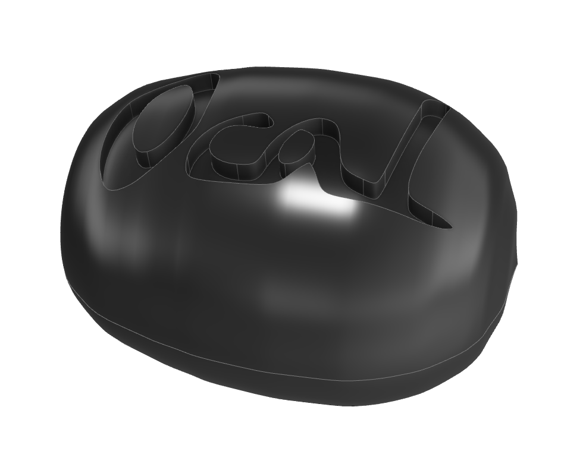
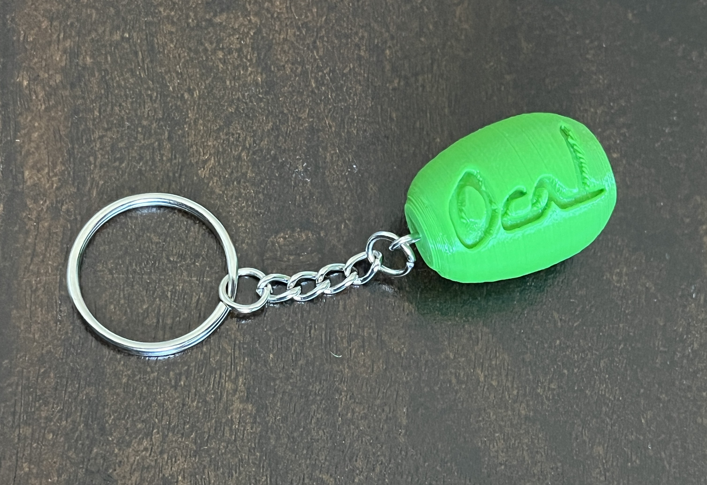
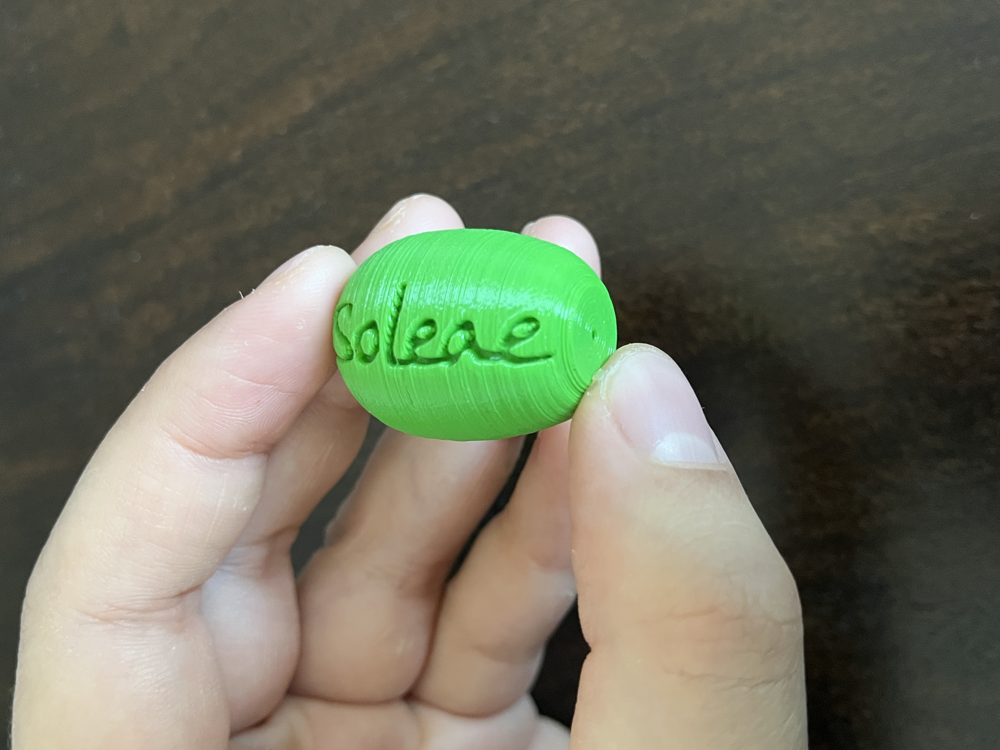
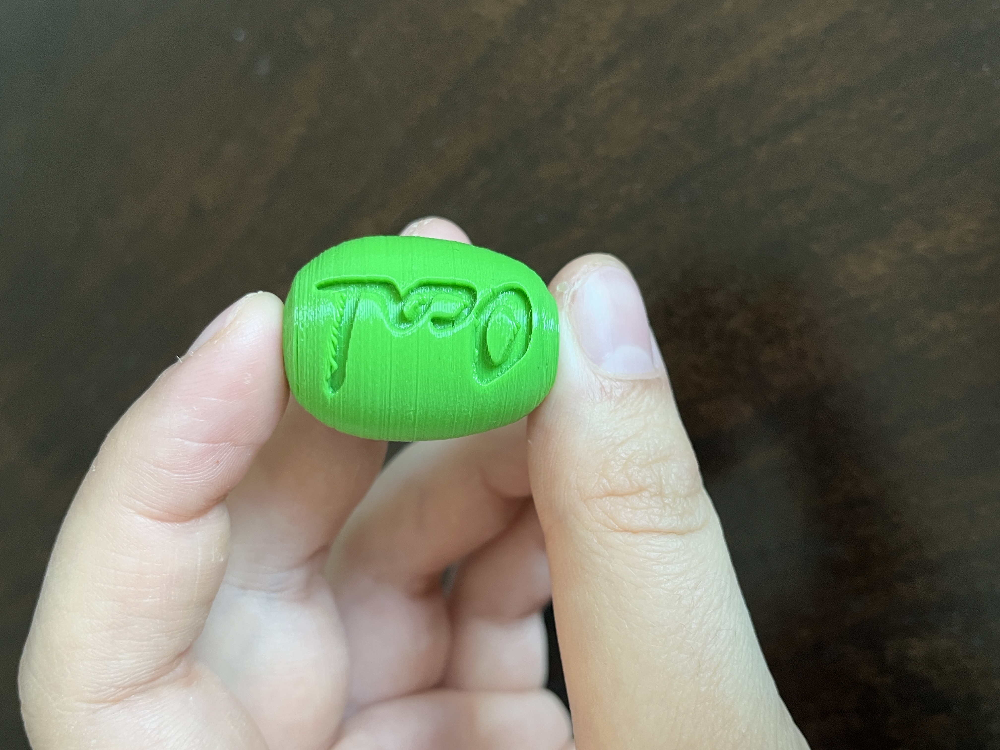

# Olive Keychain

Small olive-shaped keychain designed for 3D printing.

Rendered preview of the olive-shaped keychain.

## Files

- [olive-keychain.stl](olive-keychain.stl)

## Printed examples

Printed keychain with its metal ring attached:

Front view of the printed keychain:

Back view showing the keychain profile:

Photos are stored under `media/`.