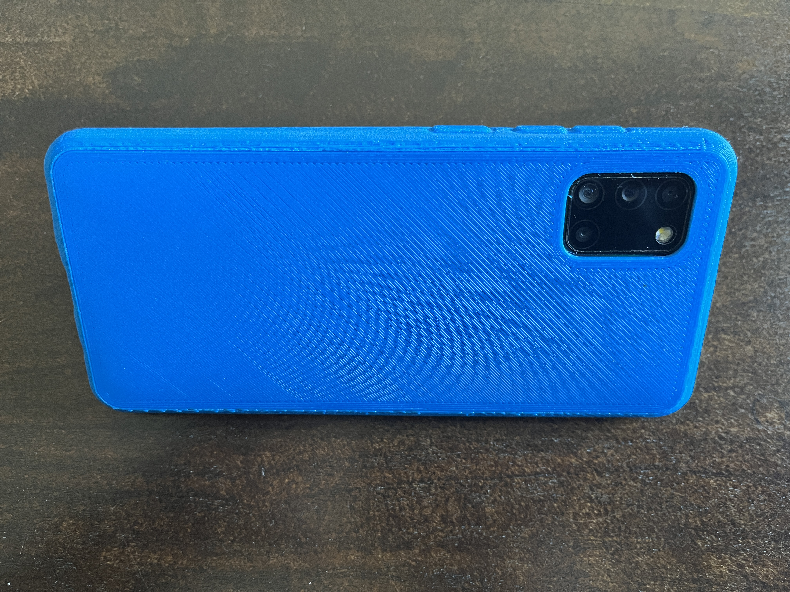
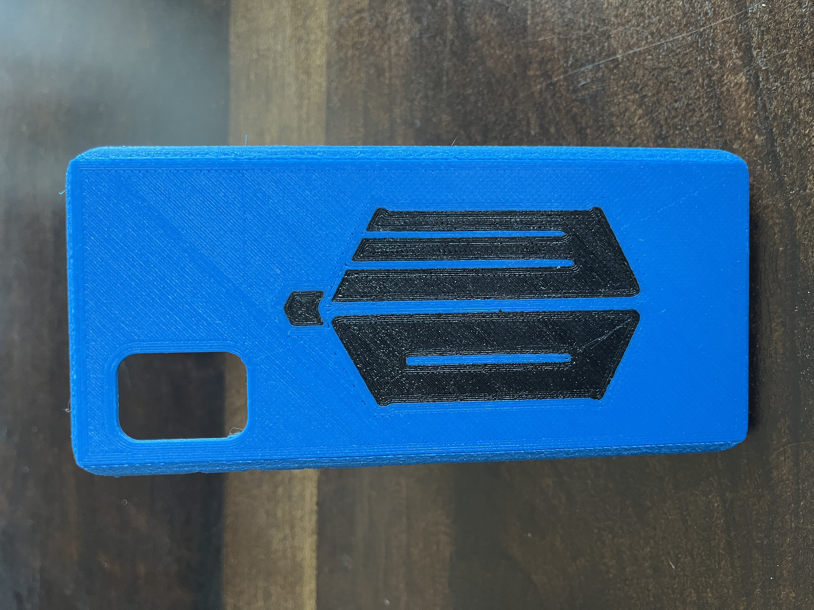
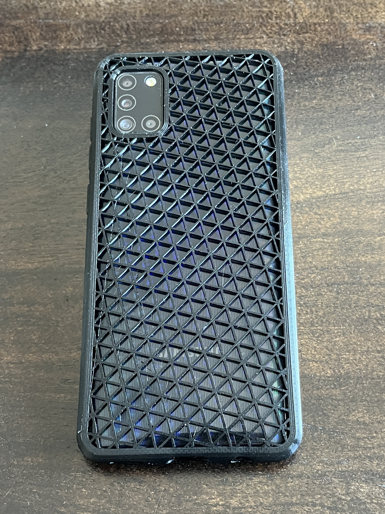
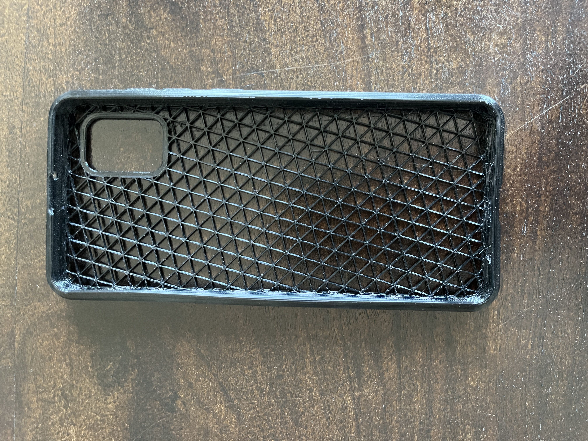
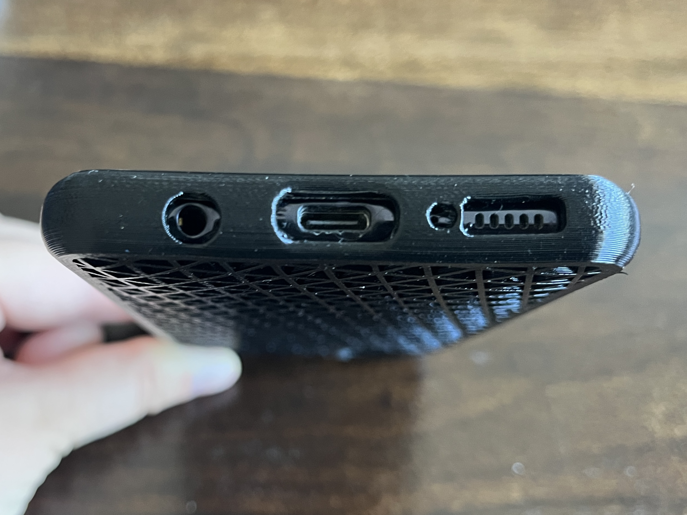
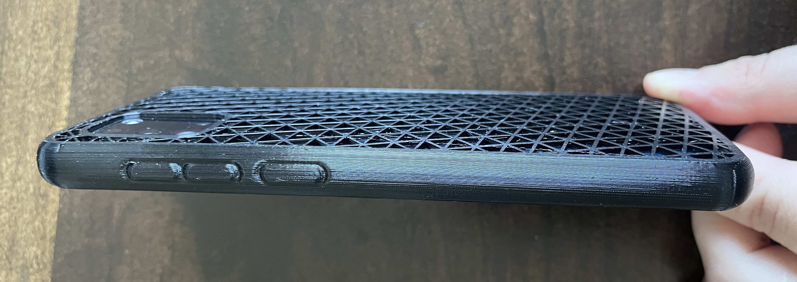

# Samsung Galaxy A31 Case

Custom phone case model for the Samsung Galaxy A31.

## Files

- [samsung-galaxy-a31-case.stl](samsung-galaxy-a31-case.stl)

## Printed examples

Blue case fitted to the phone:

Back view of the blue printed case with two colors:

Back view of the black printed case:

Interior view showing the case shape and openings:

Bottom view showing the phone ports:

Side buttons view of the black case:

Potos are stored under `media/`.
